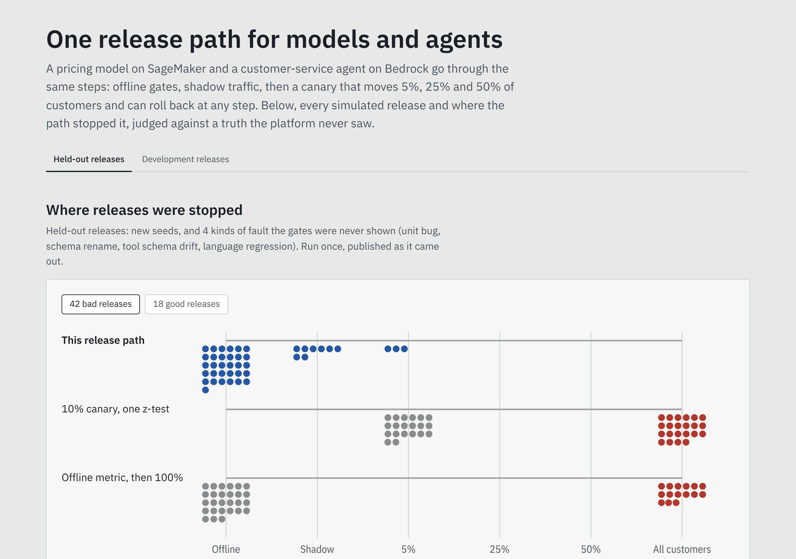
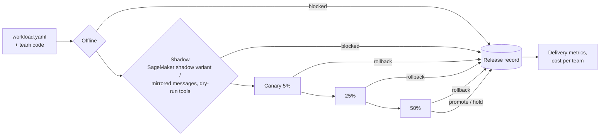

# mlops-llmops-platform

[](https://github.com/manojrevenkar12-web/mlops-llmops-platform/actions/workflows/ci.yml)

**One self-service release path for classical ML models and LLM agents.** A pricing model served on SageMaker
and a LangGraph customer-service agent on Bedrock / AgentCore go through the same steps:

1. a contract;
2. offline gates;
3. shadow traffic;
4. a canary that moves 5%, 25% and 50% of customers and can roll back at any step.

Every decision is recorded with its evidence. Spend is attributed to the team that caused it, and a new team gets
on the platform with one YAML file and its own code.

The platform is measured, not described. A simulated mobility business produces 108 candidate releases:
- retrains and better models;
- leaky features, stale data, broken online feature pipelines;
- prompts that drop a policy check, stale knowledge bases, cost blow-ups, tool API drift.

The simulated business knows which releases are actually good. The platform never sees that truth. Every
decision it makes is scored against the truth, next to two common ways of releasing models.



## Results at a glance

**Held-out set.** 60 releases on 3 new seeds, including 4 kinds of fault the gates were never shown. The gates
were pinned in `config/heldout.lock` before the run, the run happened once, and the results are published as they
came out ([RESULTS.md](RESULTS.md)).

| | This path | 10% canary, one z-test | Offline metric, then 100% |
|---|---|---|---|
| **Bad releases that reached every customer** (of 42) | **0** | 22 | 15 |
| Good releases shipped (of 18) | 12 | 17 | 15 |
| Customer requests served by bad releases before a stop | 180,000 | 584,000 | — |
| Unseen kinds of fault stopped before any customer (of 11 bad) | **11** | 8 (3 shipped) | 6 (5 shipped) |

**Where the bad releases were stopped.**
- **31 offline:**
  - stale data;
  - a slice that regressed;
  - a removed policy guard (the policy suite);
  - a stale knowledge base (the fact check);
  - cost and latency.
- **8 in shadow:** leaks, a unit change, a renamed category. The online/offline parity check names the
  feature and the share of requests.
- **3 at 5% of traffic:** conversion or the booking forecast fell.

**What it costs.**
- 6 good releases did not ship:
  - 3 near-neutral pricing retrains were *held for a person*: the canary could not show they were within 2% of
    the champion.
  - 3 were *blocked offline*:
    - a Haiku agent whose fact-error rate was not shown to be within 1 point of Sonnet's;
    - a pricing model the gate could not separate from stale data;
    - a broken online feature pipeline that happened to raise revenue.
- This path is deliberately conservative. A held release can be promoted by a named person with a reason.
  A policy-violation block cannot be overridden.

**Development set** (48 releases the gates were tuned on): 0 of 30 bad releases shipped, against 16 for the 10%
canary and 12 for offline-only. 15 of 18 good releases shipped.

| Area | What is here | Measured |
|---|---|---|
| **Contract** | One `workload.yaml` per model or agent. Kind rules (models on SageMaker, agents on AgentCore). Prices must exist. Gates can be tightened, never loosened ([contract.py](src/paved/contract.py)) | 3 workloads, 3 teams. The third was added with no platform change ([test_onboarding.py](tests/test_onboarding.py)) |
| **Offline gates** | Models: loss non-inferiority (paired bootstrap), worst slice, calibration against the champion, the holdout window kept clean. Agents: task success on a labelled set, language and phase slices, the KB fact check, a policy suite, cost and latency ([gates](src/paved/gates)) | 31 of 42 held-out bad releases stopped here |
| **Shadow** | SageMaker shadow variant with data capture. The training pipeline is replayed on the exact requests the endpoint served and compared feature by feature. Agents run against mirrored messages with tools in dry-run ([ADR 3](docs/adr/0003-parity-not-drift-in-shadow.md)) | 9 of 9 releases with a leak, a unit change or a renamed category stopped here, the feature named |
| **Canary** | Always-valid confidence sequence (mSPRT), variance-reduced with the champion's expected value (CUPED). Guardrails: conversion, latency, forecast quality, audited policy violations, escalations, cost, tool errors ([canary.py](src/paved/gates/canary.py), [ADR 2](docs/adr/0002-always-valid-canary.md)) | Error rate held under 30 looks ([test](tests/test_stats.py)). A naive z-test alarms >15% |
| **Release record** | Append-only, hash-chained event log. One idempotency key per step. Resumes mid-canary without moving traffic twice. Overrides need a named person and a reason ([events.py](src/paved/events.py), [pipeline.py](src/paved/pipeline.py)) | Tamper and crash/resume tests |
| **Agents** | LangGraph graph with a code `policy_guard` node: the model reads, code decides. Platform SDK ports (`paved.agentkit`). Bedrock Converse adapter with an application inference profile per release, guardrail, prompt caching, tool-use output ([cs_agent.py](src/paved_workloads/cs_agent.py), [bedrock.py](src/paved/serving/bedrock.py)) | Removed guard caught by the policy suite in 3 of 3 held-out releases |
| **AWS** | SageMaker shadow and canary endpoint configs and variant weights. AgentCore endpoint versions with a per-conversation split. Bedrock inference profiles. Every call checked against botocore's API models with the Stubber ([serving](src/paved/serving), [tests](tests/test_aws_adapters.py)) | 7 adapter tests |
| **Cost** | Spend per team from tags. Recommendations applied in order per workload, so savings add up: prompt caching, a cheaper model that passed the gates, Bedrock batch for async work, right-sized endpoints ([cost.py](src/paved/cost.py)) | $21,303 of $33,659 a month identified on a simulated 9-team organisation (list prices) |
| **Delivery metrics** | Lead time, change failure rate, exposure before rollback, self-service rate per team, from the release record only ([adoption.py](src/paved/adoption.py)) | `paved metrics <events>` |
| **Self-service** | `paved init` writes a contract, a code stub, a test and a CI workflow. `paved validate / status / metrics / override`. [Handbook](docs/handbook.md) for data scientists | Scaffolded contracts always validate (test) |
| **Infrastructure** | Terraform: capture bucket, Bedrock guardrail, a budget per team on the `team` tag, least-privilege control-plane role, GitHub OIDC role. Docker. Kubernetes manifests for the API ([infra/terraform](infra/terraform), [deploy/k8s](deploy/k8s)) | `tofu validate` in CI |
| **Dashboard** | React, TypeScript, Framer Motion: where releases were stopped, every release with its evidence and canary intervals, cost by team ([web](web)) | Loading, error/retry and empty states tested (vitest) |

## How it works



Models implement `features(data, online)`, `predict(frame)`, `train_to` and `complexity`. Agents build a graph
against `paved.agentkit` and expose `handle(id, text)`. Nothing in the platform knows what a model is for. The
contract names the label, the metric and the slices that matter.

## The world, and what is simulated

`paved_world` holds the truth.
- **Rental market:** quotes with a hidden, drifting price elasticity by segment, and history logged with
  randomised prices.
- **Customer service:** messages in five languages about ten intents.
- **Foundation models:** simulated, because there is no AWS account here. Each model's per-intent accuracy,
  hallucination rate, tokens and latency are hidden parameters, and the model answers through the same port the
  Bedrock adapter implements.

The platform (`src/paved`) and the team code never import the world (a test enforces it). The world exposes only
what AWS and customers would show: captured requests, outcomes, latency and billing usage.

A release is **bad** if, by the truth, any of these holds:
- **Revenue or resolution** falls by more than the canary margin.
- **A customer segment** loses badly.
- **The booking forecast** gets clearly worse.
- **Cost or latency** breaks its limit.
- **The agent breaks policy.**

## Limits

- **Simulated world.** The market, the customers and the foundation models' behaviour are simulated. The
  numbers above measure the release path, not a model's quality on real data.
- **AWS validated offline only.** The AWS adapters are checked against botocore's API models and Terraform with
  `tofu validate`. Nothing has been applied to a live account.
- **No production environment readers.** The readers that would turn SageMaker data capture, CloudWatch and
  Bedrock invocation logs into the platform's observations are not built. Their shapes are in
  [ports.py](src/paved/ports.py).
- **Invented volumes and recommendations.** Cost volumes are invented, and prices are us-east-1 list prices
  checked on 2026-11-09. Recommendations are estimates, kept apart from spend.
- **Single-node runner.** The canary runs on one process with SQLite. A production control plane would put the
  record in PostgreSQL and run steps as jobs.

## Run it

```bash
pip install -e ".[dev]"
make test          # 54 tests, about a minute
make dev           # 48 development releases through the path and both baselines (~35 min on 2 cores)
make report        # RESULTS.md and the dashboard data
cd web && npm ci && npm run dev
paved init --kind agent --name station-faq --team branch-ops --owner you@example.com
```

`AGENTS.md` has the invariants and the held-out rule. `docs/handbook.md` is the guide for data scientists.
